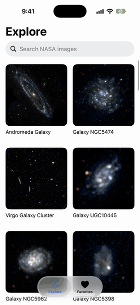
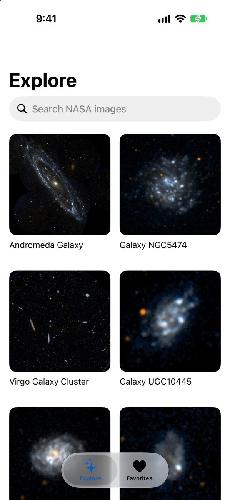
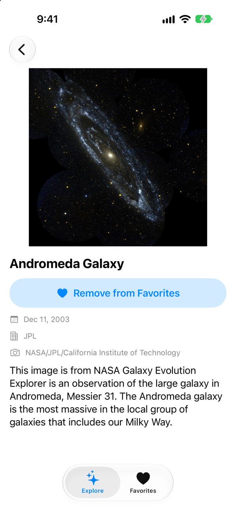
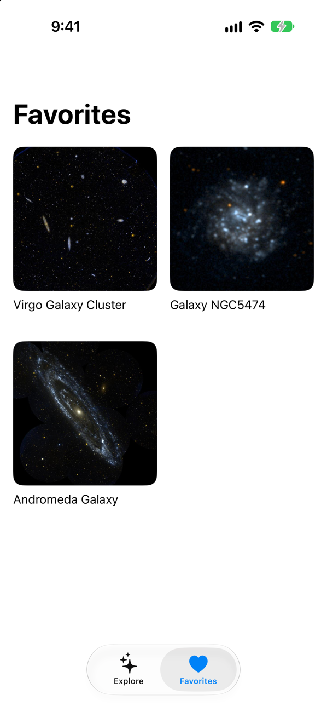
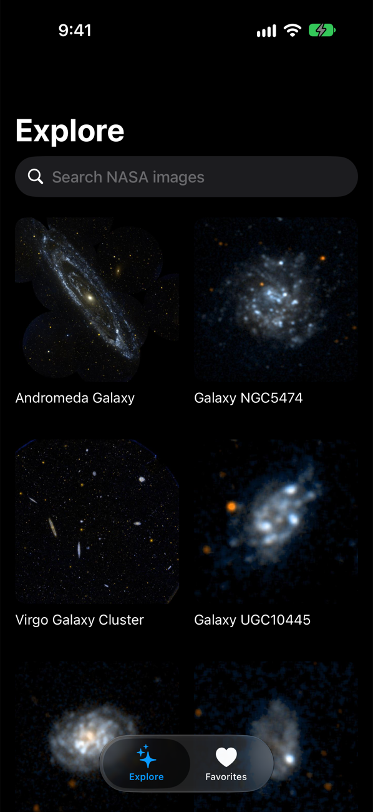
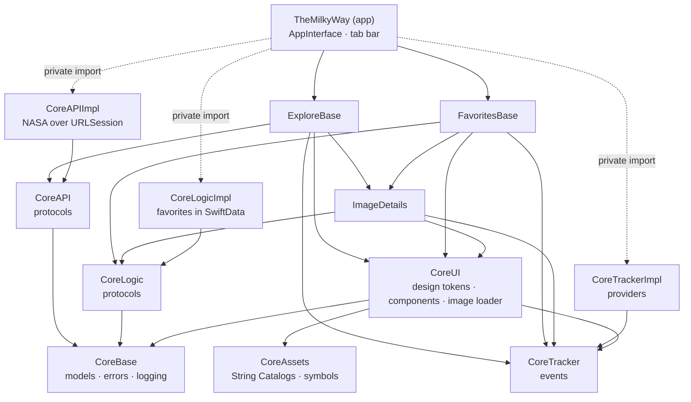

# TheMilkyWay

[](https://github.com/ysnnzlcn/TheMilkyWay/actions/workflows/ci.yml)

Browse and search NASA's image library, and keep your favorites on your phone. A small app built the way a large
one should be: Swift 6 with strict concurrency, SwiftUI, The Composable Architecture, SwiftData and a modular
Swift Package setup, fully tested with Swift Testing.

<p align="center">
  
</p>

| Explore | Image details | Favorites | Dark mode |
|:---:|:---:|:---:|:---:|
|  |  |  |  |

## Features

- **Explore:** a two-column grid that pages through NASA's results as you scroll, starting on a featured topic.
  Search waits until typing pauses, and a new search cancels the one still running.
- **Image details:** the large image, its date, center, credit and description (HTML from NASA cleaned to text).
- **Favorites:** save any image; the Favorites tab updates live from any screen and keeps working offline for
  titles and details.
- Loading, empty, error and retry states everywhere; dark mode and Dynamic Type from system styles.

## Architecture

Every module is a local Swift package. Features see only interfaces; the app target is the only place that knows the
implementations and wires them together at launch.



- **Screens** are TCA reducers (`<Name>Core`) with SwiftUI views (`<Name>View`). Navigation uses `StackState`; each
  tab owns its stack, and tapping the open tab returns to its first screen.
- **Dependency injection:** each feature module declares what it needs (`<Module>+Interface.swift`), reads it through
  TCA dependency clients, and the app fills it in `AppInterface`. Tests swap in mocks from `*Mocks` targets, which
  never ship in the app.
- **Errors** are `Result<T, AppError>`, grouped by where they happened (`.network`, `.storage`, `.unexpected`). All
  error text and its look come from one place, `AppError+Strings`. A failed first load shows a full-screen message
  with "Try again"; later failures show a toast.

## Key decisions

- **Third-party shapes stay at the edge.** NASA's raw JSON is decoded and mapped inside `CoreAPIImpl`: optional
  fields stay optional, a malformed item is dropped instead of failing the page, HTML is stripped, and paging stops
  at NASA's 10,000-result limit. Features only see clean models.
- **Own image loader instead of a library.** Images are decoded with ImageIO at the size they are drawn, kept in a
  memory cache limited by bytes and a disk cache (`URLCache`), and downloads are cancelled when a card leaves the
  screen. A card scrolled back on screen shows its image at once.
- **SwiftData behind a protocol.** The favorites service is a plain actor that opens its store on first use, off the
  main thread: a probe test showed `@ModelActor`'s default executor running on the main thread on iOS 27. The schema
  is versioned with a migration plan, and screens follow the saved list as an `AsyncStream`, so a change on one
  screen shows on all of them.
- **Tracking without an SDK in the app.** Events are enum cases (`screen_view`, `error_shown`, `favorite_added`,
  `search`…) sent to every provider. Today that is the log; an empty Firebase provider shows where analytics plugs in
  without touching any screen. No personal data: search sends the query's length, never its text.
- **Strict by default.** Swift 6 language mode, compiler warnings as errors (set per target, so third-party packages
  are unaffected), SwiftLint `--strict` with a pinned version, and every user-facing string in String Catalogs.

## Running

Requirements: **Xcode 27.2** and an **iOS 27** simulator. NASA's API needs no key.

1. Open `TheMilkyWay.xcworkspace` (not the `.xcodeproj`; the workspace connects the packages).
2. Choose the `TheMilkyWayDebug` scheme and run. On first open, Xcode asks to trust the TCA macros.

To run without a network, set `.debug` to `.stubs` in `AppInterface.apiEnvironment(for:)`.

## Tests

Swift Testing throughout, with TCA's exhaustive `TestStore` for reducers and a `TestClock` for debouncing. Covered:
every reducer action, the network layer and NASA mapping (against a fixture trimmed from a real response), the
SwiftData store (in memory and on disk), the image loader, tracking events and all strings.

```bash
xcodebuild test -workspace TheMilkyWay.xcworkspace -scheme TheMilkyWayDebug \
  -destination 'platform=iOS Simulator,name=iPhone 18 Pro' -skipMacroValidation
swiftlint lint --strict
```

CI runs both on every pull request ([workflow](.github/workflows/ci.yml)).

## Credits

Images and their descriptions come from the [NASA Image and Video Library](https://images.nasa.gov)
(`images-api.nasa.gov`). This app is an independent sample and is not affiliated with or endorsed by NASA.
